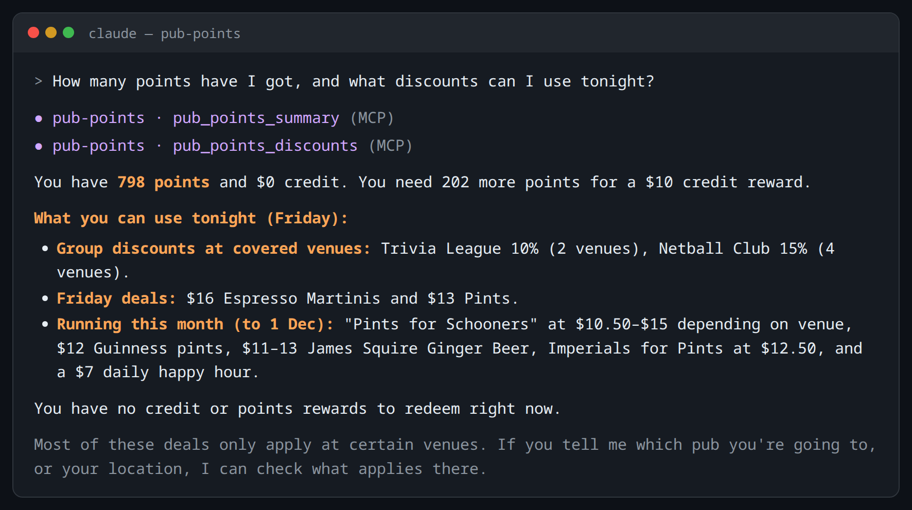

# Pub Points: The Pass, inside your AI assistant

[](https://github.com/trammel/pub-points-mcp/actions/workflows/ci.yml)
[](CHANGELOG.md)
[](LICENSE)

Ask your AI assistant how many points you've got, what deals are on tonight, and which pub is still open. pub-points-mcp connects **The Pass** (the loyalty app for Australian Venue Co pubs and bars) to Claude, Cursor, VS Code and other assistants that support [MCP](https://modelcontextprotocol.io), the standard way to give an assistant new tools. It uses your own account, and nothing changes on your account until you say yes.



> [!NOTE]
> Unofficial. Not affiliated with or endorsed by Australian Venue Co or EonX, which runs the app's loyalty platform. It uses the same API the app uses, signed in as you.

## What you can ask

- How many points have I got, and how close am I to the next tier?
- What's on tonight that I can actually use?
- Which pub did I spend the most at this year? Be honest.
- What did I order last Friday night? I need to piece it together.
- Is anywhere near Surry Hills still open?
- Any offers I haven't activated yet? Turn on the pint one. _(it asks you first)_
- Do any of my points expire before Christmas?

## Before you start

- Node.js 22 or newer.
- An account on The Pass that signs in with an **email and password**.

> [!WARNING]
> If you signed up with "Continue with Google" or "Continue with Apple", this tool can't sign you in: those sign-ins send you back to the app, not here.

## Quick start

**1. Sign in once.** Enter your email and password for The Pass when asked. Only a refresh token is stored, never the password.

```sh
npx -y github:trammel/pub-points-mcp#v0.1.0 login
```

**2. Add it to your assistant.**

Claude Code:

```sh
claude mcp add pub-points -- npx -y github:trammel/pub-points-mcp#v0.1.0
```

Claude Desktop, Cursor and other clients configured with JSON: paste this into the client's MCP settings ([where that is, and the VS Code version](docs/configuration.md#adding-it-to-your-assistant)).

```json
{
  "mcpServers": {
    "pub-points": {
      "command": "npx",
      "args": ["-y", "github:trammel/pub-points-mcp#v0.1.0"]
    }
  }
}
```

**3. Ask it** "how many points have I got?"

The `#v0.1.0` tag pins the release, so every launch runs the same code. Other ways to install, and every setting, are in [configuration](docs/configuration.md).

## What it can do

- **Points and credit:** balance, expiry, tier progress, and rewards you can redeem now.
- **Discounts:** everything that lowers your bill, including tier benefits, group discounts, offers and birthday gift.
- **Offers:** what's activated and what's still waiting, with terms and venues.
- **Orders and spending:** itemised receipts, and totals by venue and month.
- **Venues:** search by name or location, with open-now status and opening hours.
- **Actions:** activate offers, redeem points or codes, join a group discount, claim the birthday gift, and manage favourites and message settings.

All 29 tools: [docs/tools.md](docs/tools.md).

## Safety

Anything that changes your account (activating an offer, redeeming points) is checked first, then shown to you, and only happens once you say yes. To rule out changes completely, add `--read-only`. Details: [confirmations](docs/confirmations.md) and [security](SECURITY.md).

## When something breaks

The Pass can change its API without notice. This checks that the API still returns what the tools expect:

```sh
npx -y github:trammel/pub-points-mcp#v0.1.0 doctor
```

More in [troubleshooting](docs/troubleshooting.md).

## Documentation

- [Tools](docs/tools.md): every tool and what it returns
- [Confirmations](docs/confirmations.md): how account changes are confirmed
- [Configuration](docs/configuration.md): adding it to each assistant, read-only mode, environment variables, session storage, tarball installs
- [Troubleshooting](docs/troubleshooting.md)
- [How it works](docs/how-it-works.md): endpoints, sign-in and data quirks
- [Contributing](CONTRIBUTING.md) · [Security](SECURITY.md) · [Changelog](CHANGELOG.md)

## Licence

GPL-3.0-or-later. See [LICENSE](LICENSE).
